# Heat Zones

**English** · [Polski](README.pl.md)

Room-aware heating zones with a weekly schedule for [Home Assistant](https://www.home-assistant.io/). A zone is one
or more rooms (Home Assistant areas) heated by one or more thermostats. You choose where the zone measures (one
room, the average or the coldest room), and the zone drives every thermostat so that *that* place gets the target
temperature, follows its week like a programmable thermostat and starts heating early enough to be warm on time.
No cloud and no AI: Heat Zones is a thermostat, and systems like [HomeAI](https://github.com/lukasz-wieckowski/homeai)
can drive it like one.

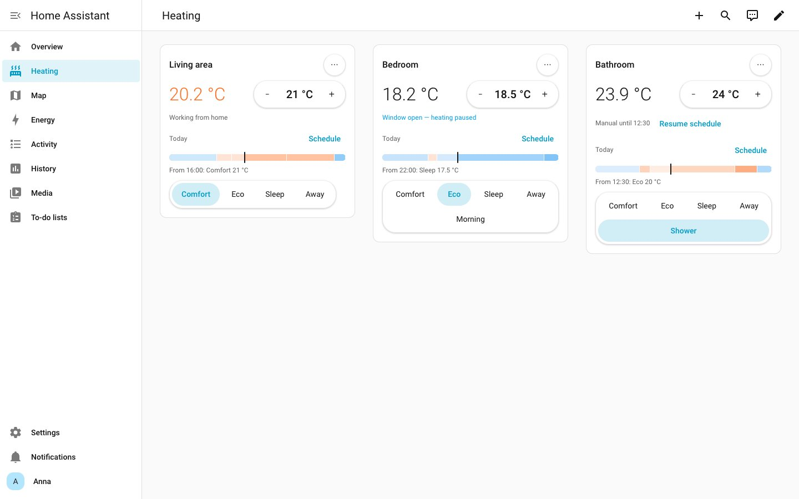

<sub>All screenshots come from a clean Home Assistant 2026.11 with a demo home (virtual thermostats, room sensors and
windows) and Heat Zones 1.0, built by [`scripts/demo`](scripts/demo/demo.mjs). Above: the living area heats while
someone works from home, the bedroom waits because its window is open, and the bathroom keeps the shower
temperature until 12:30.</sub>

## Contents

- [What Heat Zones does](#what-heat-zones-does)
- [Requirements](#requirements)
- [Installation](#installation)
- [First setup](#first-setup)
- [User manual](#user-manual):
  [The card](#the-card) · [Schedule](#schedule) · [Overrides](#overrides) ·
  [Manual changes and holds](#manual-changes-and-holds) · [Settings](#settings) · [On the phone](#on-the-phone)
- [How a zone works](#how-a-zone-works)
- [Entities](#entities)
- [Services and automations](#services-and-automations)
- [Theming](#theming)
- [Contract for other systems](#contract-for-other-systems)
- [Troubleshooting and FAQ](#troubleshooting-and-faq)
- [Development and license](#development-and-license)

## What Heat Zones does

- **Heats rooms, not radiators.** Thermostats with a room sensor input (SONOFF TRVZB / TRV-ZBT and others) get the
  temperature from the room; thermostats without one get a target corrected by the difference between their own
  thermometer and the room.
- **Measures where you live.** One room, the average or the coldest room of the zone, with limits per room: “the
  kitchen never warmer than 23 °C” while the zone measures the average.
- **Follows a week.** A weekly schedule per zone, **preheat** (optimum start) from a learned thermal model, **manual
  changes that last until the next change**, **holds** until a time or permanently, and **timed overrides**
  (guests, working from home, a trip).
- **Copes with real homes.** It waits while a window is open, keeps heating **without sensors** (on the thermostats'
  own thermometers), **repeats lost commands** and **takes over a turn of the knob**.
- **Repairs itself.** A thermostat that quietly went back to its own thermometer (seen after a firmware update) is
  switched back, and only when that fails you get a problem report. A **valve guard** notices a valve that stays
  open while the room does not get warmer.
- **Learns** the differences between the rooms, the heating rate and a **thermal model** (cooling, heating power,
  outside temperature, wind), also from Home Assistant's history.
- **Has a card for every day.** The zone now, today's plan and the presets at a glance; the week, the overrides and
  the settings one tap away. It is included, registered automatically and follows your theme.
- **Talks to other systems.** The plan for the next 36 hours, problems as signals, and services to read and change
  the schedule ([contract](#contract-for-other-systems)).

## Requirements

- Home Assistant **2026.11** or newer.
- Thermostats as `climate` entities, placed in areas. Temperature sensors in the rooms are strongly recommended.
- Optional: an outdoor temperature sensor or a weather entity with an hourly forecast (better preheat).

## Installation

**With HACS**

1. Open HACS → ⋮ → *Custom repositories*, add `https://github.com/lukasz-wieckowski/heat-zones`, category
   **Integration**.
2. Find **Heat Zones** in HACS, install it and restart Home Assistant.

**Manually**

1. Copy `custom_components/heat_zones` into `config/custom_components/` of your Home Assistant.
2. Restart Home Assistant.

## First setup

**Settings → Devices & services → Add integration → Heat Zones.** The wizard asks for an optional outdoor
temperature sensor and weather entity (both make preheat better) and offers to create a zone for every area with a
thermostat. Every zone then has its own place on the integration's page, with a device and its entities:

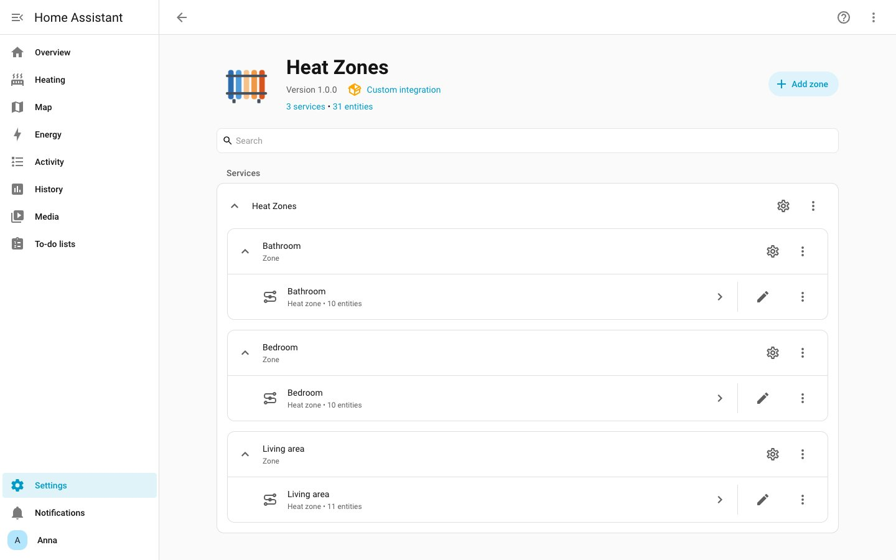

**Add zone** adds one, the gear on a zone (**Change zone**) changes it, and its **⋮ → Delete** removes it. The
zone form has four steps:

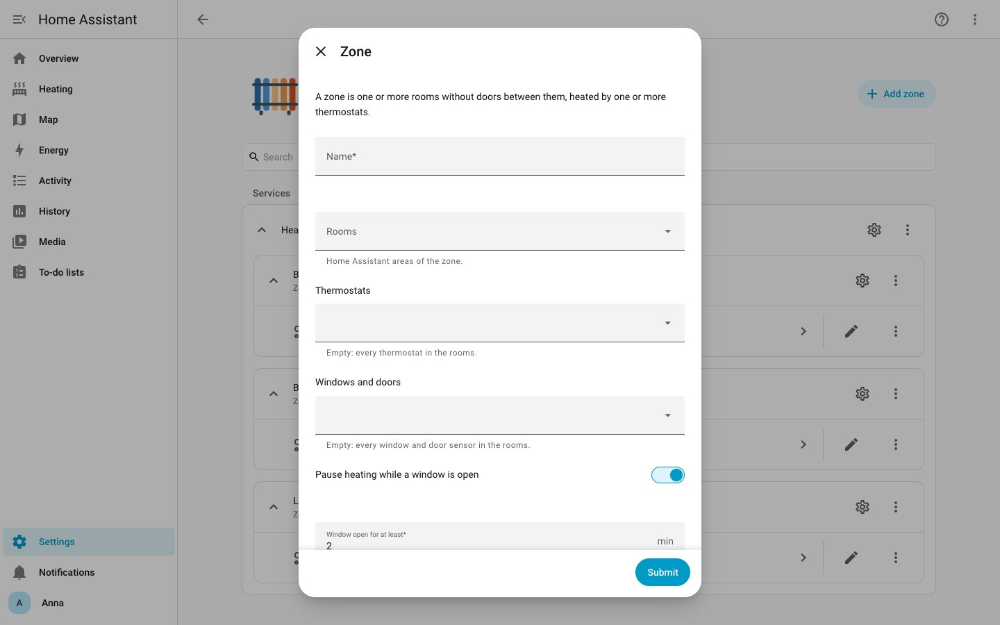

| Step | What it asks |
|---|---|
| Zone | the name, the rooms (areas), the thermostats (empty: every thermostat in the rooms), the windows and doors (empty: every opening sensor in the rooms), the window pause and its delay |
| One step per room | the room's temperature sensor (empty: the area's temperature sensor, else one found in the room) and an optional limit |
| Presets | the temperatures of Comfort, Eco, Sleep and Away, and your own presets, one per line (`Shower: 24`) |
| Control | how the thermostats are driven (automatic, room sensor input, corrected target, own thermometer), the largest target correction, preheat on or off and how early it may start, and companion entities when they are not found automatically |

**Configure** on the integration has the outdoor sensor, the weather and **Heating start**: the day your heating
season started. The zones then learn how the rooms cool from the nights before it, so preheat is accurate from the
first day.

Last, put the card on a dashboard: *Edit dashboard → Add card → Heat Zones*, or in YAML:

```yaml
type: custom:heat-zones-card
entity: climate.living_area
```

## User manual

### The card

The card answers the everyday question, how warm it is and what happens today, and keeps everything else one tap
away (see the screenshot at the top).

| Part | What it shows and does |
|---|---|
| Name and **⋯** | the zone; **⋯** opens its [settings](#settings) |
| Temperature | at the zone's measuring point, in the heating colour while the zone heats |
| **−** target **+** | changes the target by 0.5 °C (a [manual change](#manual-changes-and-holds)) |
| Reason | why the zone holds this target: the schedule, an override (its reason, like *Working from home*), a manual change, preheat or the window pause. While a manual change is held, **Resume schedule** sits next to it |
| Today | today's schedule and overrides as a strip from midnight to midnight, cooler targets blue and warmer ones orange; the past is dimmed and a line marks now. Below it, the next change. **Schedule** (or the strip) opens the [week](#schedule) |
| Presets | Comfort, Eco, Sleep, Away and your own, the active one tinted. When the zone is off, a single **Turn heating on** button takes their place |

Administrators also see the zone's problems (a silent sensor, a stuck valve…) under the reason.

Card options, all optional: `title` (instead of the zone's name), and `show_controls` (the target and the presets),
`show_schedule` (the strip and the schedule) and `show_overrides` (the overrides in the schedule sheet), all on by
default. The card editor has them as switches.

### Schedule

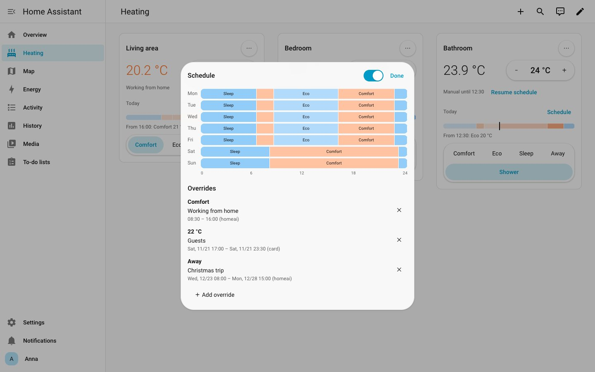

**Schedule** opens the week in a sheet. The switch at the top turns the schedule on and off (off: the zone keeps
manual settings). Every day is a bar from 0 to 24 h; a block lasts until the next one, across days and weeks. The
overrides are listed under the week.

Tap a day to change it:

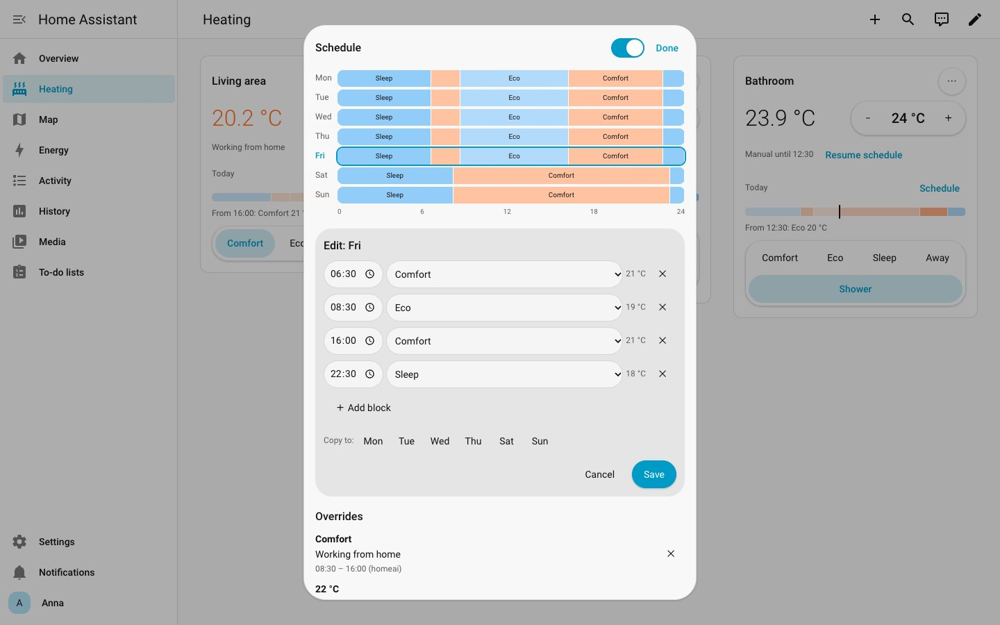

Every block is a time and a preset or a temperature; the preset's temperature is shown next to it. **Add block**
adds one two hours after the last, **✕** removes one, and **Copy to** copies the day to the days you pick when you
save. **Save** writes the week, **Cancel** drops the changes.

### Overrides

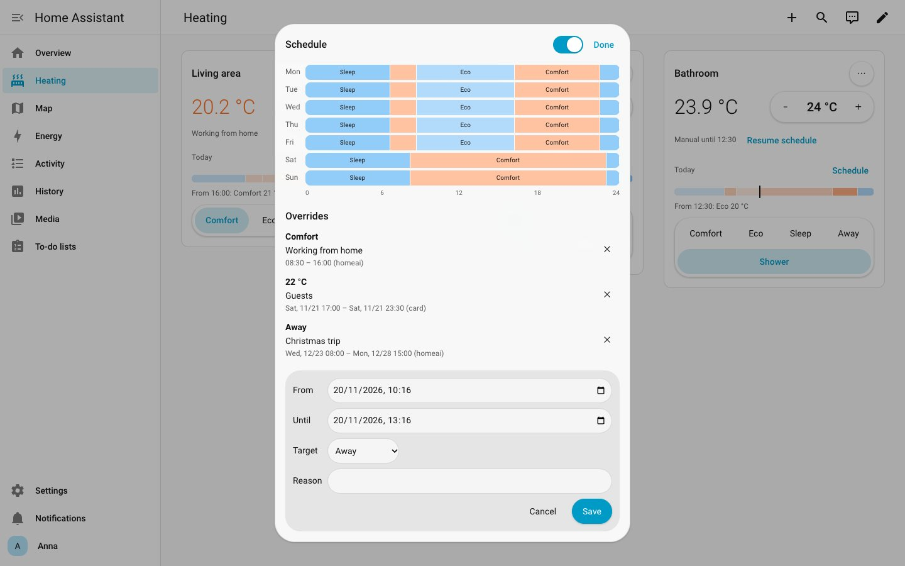

An override is a target for a while: from, until, a preset or a temperature, and a reason. It beats the schedule
and disappears by itself when it ends. **Add override** opens the form (from now, for three hours), and **✕**
removes one. Each override shows where it came from: `card` from this form, `homeai` from HomeAI, or the `source`
of whatever called `heat_zones.add_override`. Above, HomeAI keeps the living area comfortable while someone works
from home, guests come tomorrow evening, and the whole home is *Away* over Christmas.

### Manual changes and holds

A change from the card (**−** / **+**, a preset), the thermostat's knob, a remote, voice or another system is a
**manual change**. With the schedule on, it lasts **until the next change**: the next block, or the start or end of
an override. To keep it longer, open **⋯** and choose **Hold permanently** (the schedule waits until you resume) or
**Hold until** a time. **Resume schedule** goes back to the schedule at once.

Between overrides and manual changes **the newest instruction wins**: a manual change beats a running override; an
override that starts later beats an earlier hold, and when it ends the hold is back.

### Settings

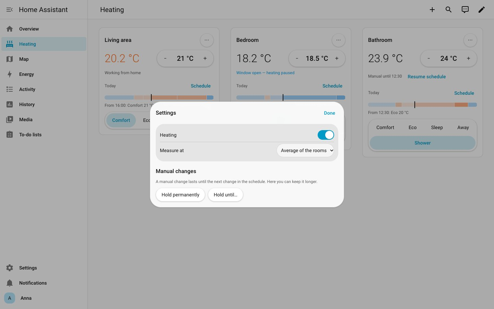

**⋯** opens the zone's settings:

- **Heating**: on or off. Off turns the thermostats off and the schedule waits.
- **Measure at**: a room, the average of the rooms or the coldest room (zones with more than one room sensor).
- **Manual changes**: hold the current manual change permanently or until a time, or resume the schedule.

Everything else about a zone is in its configuration: the gear on the zone (**Change zone**) on the integration's
page.

### On the phone

<p>
  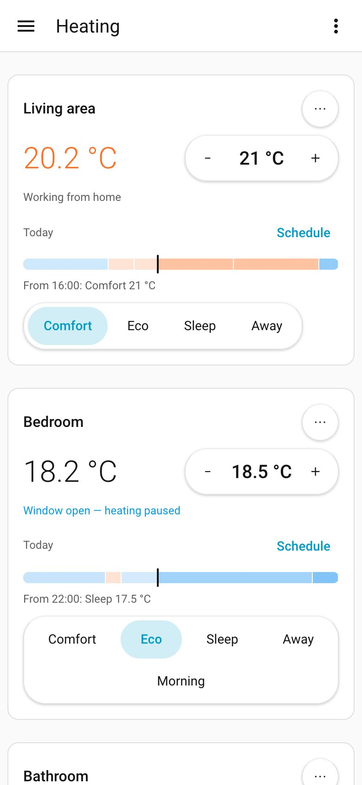
  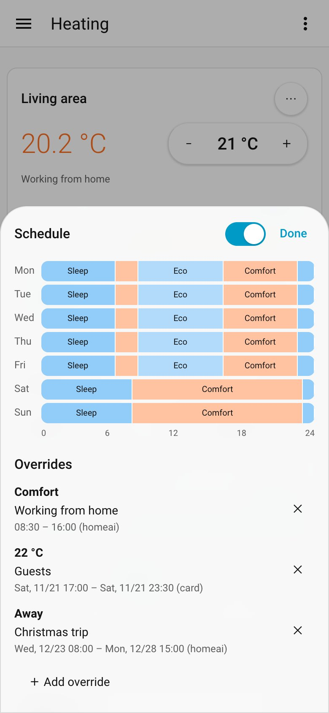
</p>

On a phone the cards take the full width and the sheets rise from the bottom. A sheet closes with **Done**, the
Escape key or a tap outside it.

## How a zone works

**Measuring point.** `select.<zone>_measure_at`: a room, `average` or `coldest`. If the chosen room's sensor is
silent the zone uses the other rooms; with no room reading at all for 15 minutes the thermostats fall back to
their own thermometers and the zone reports a problem. A shorter gap, such as sensors without a value for a moment
after a restart of Home Assistant or Zigbee2MQTT, changes nothing.

**Thermostat control** (per thermostat, *automatic* by default):

| Mode | When | What the zone sends |
|---|---|---|
| Room sensor input | the thermostat has an external temperature input (found by `unique_id`, e.g. Zigbee2MQTT `external_temperature_input` and `temperature_sensor_select`) | the room temperature (raised by limited rooms) and the zone target |
| Corrected target | no such input, but room sensors | target + (thermostat thermometer − room), smoothed and limited (default ±3 °C) |
| Own thermometer | no room sensors, or chosen | the zone target |

**Room limits.** For every room with a limit the zone feeds
`max(point, T_room − (limit − target))`, so the thermostat closes when the limited room reaches its limit. The
climate entity shows which room limits the zone (`limited_by`) and, from learning, the highest temperature the
measuring point can reach (`max_reachable`).

**Window pause.** A window or door open longer than the delay (default 2 min) turns the thermostats off until
it closes (`binary_sensor.<zone>_window_pause`). Long open windows while heating also become a signal.

**Valve limit.** When thermostats have a valve opening setting, `number.<zone>_valve_limit` sets it for all of them.

**What the zone holds.** From the bottom:

1. **Schedule** (when on and not empty), otherwise the manual target.
2. **Overrides**: from–to, a preset or a temperature, with a reason and a source. They beat the schedule and
   disappear by themselves.
3. **Manual changes**: until the next change with the schedule on; held until a time or permanently with
   `heat_zones.hold`, back to the schedule with `heat_zones.resume`.

**Preheat (optimum start).** Before a warmer step the zone starts heating early enough to reach it on time, from
the thermal model, the measured temperature and the outside temperature forecast, at most *Start preheating at
most* hours early (default 3). Until the model has learned, defaults are used; it gets accurate after a few days
of heating (or right away with *Heating start*).

**Learning.** The zone learns the offset of every room against the measuring point, the heating rate and the
thermal model (cooling, heating power, the effect of the outside temperature and the wind). The diagnostic
sensors show how far it got; `heat_zones.reset_learning` starts again.

`sensor.<zone>_next_change` shows when the target changes next, to what and why (`schedule`, `override`,
`hold`, `preheat`).

## Entities

Every zone is a device with these entities:

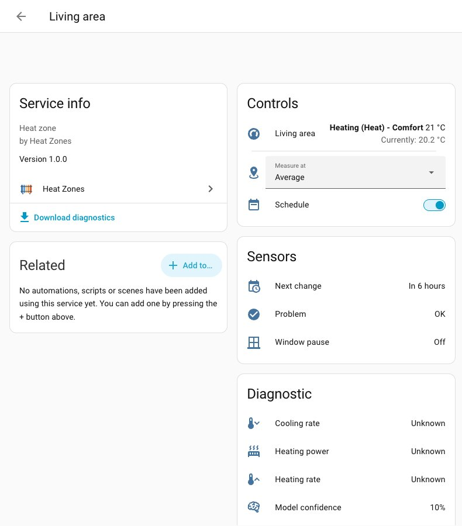

| Entity | What |
|---|---|
| `climate.<zone>` | target at the measuring point, `heat`/`off`, presets `comfort`, `eco`, `sleep`, `away` and your own; attributes below |
| `switch.<zone>_schedule` | the schedule on/off |
| `sensor.<zone>_next_change` | the next change (timestamp; `temperature`, `preset_mode`, `source`, `reason`) |
| `select.<zone>_measure_at` | where the zone measures (zones with more than one room sensor) |
| `binary_sensor.<zone>_problem` | something needs attention (`device_class: problem`) |
| `binary_sensor.<zone>_window_pause` | heating paused by an open window |
| `number.<zone>_valve_limit` | valve opening limit (thermostats with such a setting) |
| `sensor.<zone>_heating_rate`, `_cooling_rate`, `_heating_power`, `_model_confidence`, `_room_samples` | learning and the thermal model (diagnostic) |

Climate attributes: `measure_at`, `rooms` (temperature, sensor, limit, learned offset and predicted temperature
per room), `thermostats` (entity and control mode), `room_temperature_sent`, `limited_by`, `max_reachable`,
`reach_at` (when the target is expected), `window_pause`, `open_windows`, `problem`, `source`, `reason`,
`override_id`, `hold`, `schedule_enabled`, `preset_temperatures`, `next_change`, and the contract attributes.

## Services and automations

| Service | What it does |
|---|---|
| `heat_zones.hold` | keeps a temperature or a preset `until` a time or `permanent`ly |
| `heat_zones.resume` | back to the schedule |
| `heat_zones.add_override` / `remove_override` | a target for a while, with a reason and a source |
| `heat_zones.get_schedule` / `set_schedule` | read or replace the week (and read the overrides) |
| `heat_zones.estimate` | minutes of heating needed to reach a temperature |
| `heat_zones.reset_learning` | forget what the zone learned |

The standard `climate` actions work too: to set a preset on every zone at once, call `climate.set_preset_mode` with
all zone thermostats as the target. The fields and responses are in the
[contract](#contract-for-other-systems).

**Away while nobody is home**, and back when someone comes:

```yaml
- alias: Heating away while nobody is home
  triggers:
    - trigger: numeric_state
      entity_id: zone.home
      below: 1
      for: { minutes: 30 }
  actions:
    - action: heat_zones.hold
      target:
        entity_id: [climate.living_area, climate.bedroom, climate.bathroom]
      data:
        preset_mode: away
        permanent: true
- alias: Heating back when someone comes home
  triggers:
    - trigger: numeric_state
      entity_id: zone.home
      above: 0
  actions:
    - action: heat_zones.resume
      target:
        entity_id: [climate.living_area, climate.bedroom, climate.bathroom]
```

**Guests on Saturday evening**, in a script or an automation:

```yaml
action: heat_zones.add_override
target:
  entity_id: climate.living_area
data:
  start: "2026-11-21T17:00:00"
  end: "2026-11-21T23:30:00"
  temperature: 22
  reason: Guests
  source: script
```

**Tell me when a zone has a problem:**

```yaml
- alias: Heating problem
  triggers:
    - trigger: state
      entity_id: binary_sensor.living_area_problem
      to: "on"
      for: { minutes: 10 }
  actions:
    - action: notify.notify
      data:
        message: >-
          {{ state_attr('climate.living_area', 'homeai_signals') | map(attribute='title') | join('; ') }}
```

## Theming

The card and the two editor elements have no colours, fonts, sizes, radii, shadows or spacing of their own: all of
them come from the Home Assistant theme. Out of the box the card follows the active theme, light or dark. A theme
(or a card that embeds `<heat-zones-schedule-editor>` / `<heat-zones-overrides>`) can restyle it with the
variables below, without touching the rest of Home Assistant. Set them in a theme (without the leading `--`), on a
parent element, or on the card element itself. The card frame (`ha-card`: background, border, radius, shadow)
follows the usual `--ha-card-*` variables, like every card.

The default look follows Apple's Liquid Glass, carried over to the web. Content (temperatures, the week, the list
of overrides) stays plain; glass is only for the controls floating over it. Controls that belong together share one
glass container (the presets, the holds, the − / + stepper), and the buttons inside are not glass themselves. The
selected option is tinted, the main action (Save, Hold) is filled with the accent colour, corners are concentric
(container = control + padding), and editing a day or adding an override opens in a raised glass sheet. Pressing a
control gives a short scale feedback. With *reduce transparency* or *more contrast* set in the system the glass
turns solid (more contrast also draws stronger edges), and with *reduce motion* there is no press animation.

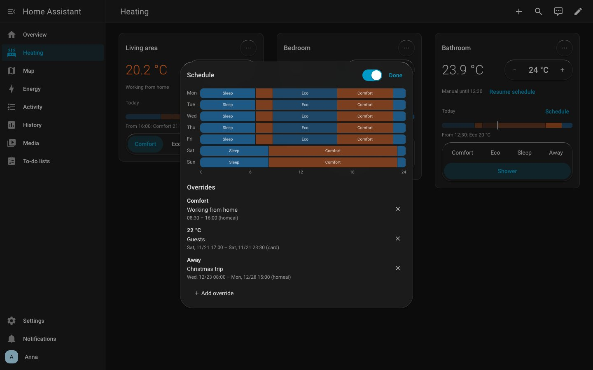

```yaml
# themes.yaml
my_theme:
  heat-zones-accent-color: "#e0a040"
  heat-zones-heating-color: "#ff7a1a"
  heat-zones-button-border-radius: 6px
  heat-zones-schedule-strength: 100%
```

**Type**

| Variable | Default | Used for |
| --- | --- | --- |
| `--heat-zones-font-family` | `--ha-font-family-body` | All text (HA's successor of `--primary-font-family`) |
| `--heat-zones-font-size` | `--ha-font-size-m` | Body text |
| `--heat-zones-small-font-size` | `--ha-font-size-s` | Secondary lines, day names, problems |
| `--heat-zones-tiny-font-size` | `--ha-font-size-xs` | Labels on the day bars, hours |
| `--heat-zones-title-font-size` | `--ha-font-size-l` | Zone name, section titles |
| `--heat-zones-title-font-weight` | `--ha-font-weight-medium` | Titles, selected buttons and days, target |
| `--heat-zones-temperature-font-size` | `--ha-font-size-4xl` | Current temperature |
| `--heat-zones-temperature-font-weight` | `--ha-font-weight-light` | Current temperature |
| `--heat-zones-target-font-size` | `--ha-font-size-xl` | Target between − and + |
| `--heat-zones-line-height` | `--ha-line-height-normal` | All text |
| `--heat-zones-condensed-line-height` | `--ha-line-height-condensed` | Current temperature |

**Spacing and shape**

| Variable | Default | Used for |
| --- | --- | --- |
| `--heat-zones-card-padding` | `--ha-space-4` | Inside the card |
| `--heat-zones-gap` | `--ha-space-2` | Between buttons, rows and list items |
| `--heat-zones-small-gap` | `--ha-space-1` | Between day bars, under the temperature |
| `--heat-zones-section-gap` | `--ha-space-4` | Above and below the section dividers |
| `--heat-zones-control-height` | `--ha-space-10` | Minimum height of buttons and fields (touch target) |
| `--heat-zones-control-padding` | `--ha-space-2` `--ha-space-4` | Inside buttons |
| `--heat-zones-input-padding` | `--ha-space-1` `--ha-space-2` | Inside fields |
| `--heat-zones-group-padding` | `--ha-space-1` | Inside a glass group, around its buttons |
| `--heat-zones-sheet-padding` | `--ha-space-3` | Inside a sheet |
| `--heat-zones-bar-height` | `--ha-space-6` | Day bars of the schedule |
| `--heat-zones-ribbon-height` | `--ha-space-3` | The strip of today on the card |
| `--heat-zones-border-width` | `--ha-border-width-sm` | Edges of glass, fields and dividers |
| `--heat-zones-focus-width` | `--ha-border-width-md` | Outline of the day being edited |
| `--heat-zones-button-border-radius` | `--ha-border-radius-pill` | Buttons (capsules) |
| `--heat-zones-icon-button-border-radius` | `--ha-border-radius-pill` | −, +, ✕ and the day buttons |
| `--heat-zones-input-border-radius` | `--ha-border-radius-pill` | Fields |
| `--heat-zones-group-border-radius` | half the control height + group padding | Glass groups (concentric with their buttons) |
| `--heat-zones-sheet-border-radius` | half the control height + sheet padding | Sheets (concentric with their fields) |
| `--heat-zones-bar-border-radius` | `--ha-border-radius-md` | Day bars |
| `--heat-zones-ribbon-border-radius` | `--ha-border-radius-pill` | The strip of today |

**Colours**

| Variable | Default | Used for |
| --- | --- | --- |
| `--heat-zones-text-color` | `--primary-text-color` | Text |
| `--heat-zones-secondary-text-color` | `--secondary-text-color` | Secondary lines, day names, hours |
| `--heat-zones-disabled-text-color` | `--disabled-text-color` | Disabled buttons |
| `--heat-zones-accent-color` | `--primary-color` | Selected buttons, the day being edited, Save |
| `--heat-zones-on-accent-color` | `--text-primary-color` | Text on the accent colour |
| `--heat-zones-selected-color` | 18 % of the accent colour | Tint of the selected option |
| `--heat-zones-hover-color` | `--secondary-background-color` | Button under the pointer |
| `--heat-zones-divider-color` | `--divider-color` | Fields and dividers |
| `--heat-zones-input-background-color` | `--input-fill-color` | Fields |
| `--heat-zones-inset-color` | `--secondary-background-color` | Panels inside a sheet (settings, the day being edited) |
| `--heat-zones-past-color` | 55 % of `--card-background-color` | Veil over the part of today that has passed |
| `--heat-zones-switch-off-color` | `--disabled-color` | Switch track when off (on uses the accent colour) |
| `--heat-zones-switch-knob-color` | `--text-primary-color` | Switch knob |
| `--heat-zones-track-color` | `--secondary-background-color` | Day bar without blocks |
| `--heat-zones-heating-color` | `--state-climate-heat-color` | Current temperature while the zone heats |
| `--heat-zones-window-color` | `--state-binary_sensor-window-on-color`, else `--info-color` | Reason line during the window pause |
| `--heat-zones-problem-color` | `--state-binary_sensor-problem-on-color`, else `--error-color` | Problems of the zone (from `homeai_signals`) |

**Glass**

| Variable | Default | Used for |
| --- | --- | --- |
| `--heat-zones-glass-color` | `--card-background-color` | Colour of the glass material |
| `--heat-zones-glass-opacity` | `70%` | How much of it covers what lies beneath (100% = solid) |
| `--heat-zones-glass-blur` | `--ha-space-4` | Blur of what lies beneath |
| `--heat-zones-glass-border-color` | `--divider-color` | Edge of the glass |
| `--heat-zones-glass-highlight-color` | the edge mixed with `--ha-color-white` | Lit top edge |
| `--heat-zones-glass-shadow` | `--ha-box-shadow-s` | Depth of groups, buttons and the main action |
| `--heat-zones-sheet-shadow` | `--ha-box-shadow-m` | Depth of sheets |
| `--heat-zones-sheet-opacity` | `92%` | How solid the sheets are |
| `--heat-zones-scrim-filter` | `--ha-dialog-scrim-backdrop-filter` | How the page behind an open sheet is dimmed |
| `--heat-zones-sheet-duration` | `--ha-animation-duration-normal` | A sheet rising into view |
| `--heat-zones-transition-duration` | `--ha-animation-duration-fast` | Press and hover feedback |
| `--heat-zones-press-scale` | `0.97` | Size of a control while pressed |

**Schedule bars.** A block's colour is its target on a cool–warm scale: below 19.75 °C the cold colour, from
19.75 °C the warm one, mixed into the base colour — a third of `--heat-zones-schedule-strength` next to the middle,
all of it at 16 °C and below or 23 °C and above (`color-mix(in srgb, tone share × strength, base)`).

| Variable | Default | Used for |
| --- | --- | --- |
| `--heat-zones-cold-color` | `--state-climate-cool-color` | Cooler targets |
| `--heat-zones-warm-color` | `--state-climate-heat-color` | Warmer targets |
| `--heat-zones-unknown-color` | `--disabled-color` | A preset without a temperature |
| `--heat-zones-schedule-base-color` | `--card-background-color` | What the colours are mixed into; lines between blocks |
| `--heat-zones-schedule-text-color` | `--primary-text-color` | Labels on the bars |
| `--heat-zones-schedule-strength` | `70%` | How strong the colours get at the ends of the scale |

**Parts.** Where a variable is not enough, style the elements with `::part()`. A part can carry a state name as
well, e.g. `::part(segment warm)` or `::part(button active)`. The card passes on the parts of the editors, so
`heat-zones-card::part(segment)` works too.

```css
heat-zones-card::part(title) { text-transform: uppercase; }
heat-zones-schedule-editor::part(day-bar) { border-radius: 0; }
```

| Element | Parts (state names) |
| --- | --- |
| `heat-zones-card` | `card`, `header`, `title`, `temperature` (`heating`), `reason` (`window`), `problem`, `today`, `segment` (`cold`, `warm`, `unknown`), `past`, `now`, `next`, `target` (`group`, `glass`), `target-value`, `controls` (`group`, `glass`), `button` (`active`, `primary`, `icon`, `glass`, `link`), `dialog`, `sheet` (`glass`), `sheet-title`, `section-title`, `settings` (`inset`), `setting`, `switch` (`on`), `input`, `message` |
| `heat-zones-schedule-editor` | `week`, `day-label` (`selected`), `day-bar` (`selected`), `segment` (`cold`, `warm`, `unknown`), `hours`, `blocks` (`sheet`, `glass` or `inset`), `sheet-title`, `block`, `input`, `button` (`active`, `primary`, `icon`), `message` |
| `heat-zones-overrides` | `list`, `override`, `form` (`sheet`, `glass` or `inset`), `input`, `button` (`primary`, `icon`, `glass`), `message` |

`::part(glass)` reaches every glass surface at once, e.g. to give them a different material.

## Contract for other systems

Heat Zones publishes what it will do and accepts changes from systems such as HomeAI. Any thermostat integration
can implement the same contract.

**Attributes of `climate.<zone>`:**

- `homeai_schedule` = `{"version": 1, "domain": "heat_zones", "areas": [...], "features": ["open_end"]}` — this
  thermostat supports the contract; `areas` (optional for other implementations) are the ids of the areas the zone
  heats (the zone's own device has no area, so systems should read the rooms from here); `features` lists the
  optional parts of version 1 it understands — senders use `open_end` only with thermostats that list it.
- `homeai_plan` = list of `{start, title, end?}` (ISO times): the schedule, overrides, holds and preheat of the
  next 36 hours, at most 50 entries. Empty while the zone is off.
- `homeai_signals` = list of `{id, title, severity 0–4, category, description?, need?, group?}` — the zone's
  problems (silent sensor, stuck valve, open window while heating, thermostat not using the room sensor,
  thermostats unavailable), as described in HomeAI's
  [docs/integrations.md](https://github.com/lukasz-wieckowski/homeai/blob/main/docs/integrations.md).

**Services** — targets are the zones' climate entities (entity, device, area or label targets work):

| Service | Fields | Response |
|---|---|---|
| `heat_zones.add_override` | `end` (required), `start` (default now), exactly one of `preset_mode` / `temperature`, `reason` (≤ 200 characters), `source`, `override_id` (the same id replaces the override), `open_end` (optional, default false) | `{override_id}` |
| `heat_zones.remove_override` | `override_id` or `source` (removes all overrides from that source); without a target: every zone | `{removed}` |
| `heat_zones.get_schedule` | without a target: every zone | `{entity_id: {enabled, weekly: [{days: ["mon", …], time: "HH:MM", preset_mode \| temperature}], overrides: [{override_id, start, end, preset_mode \| temperature, reason, source, open_end?}]}}` |
| `heat_zones.set_schedule` | `weekly` in the same format | — |
| `heat_zones.estimate` | `temperature` | `{entity_id: {minutes \| null, confidence 0–1}}` |
| `heat_zones.reset_learning` | — | — |

Details:

- `add_override` with an `override_id` that does not exist yet creates it under that id (upsert); `override_id` is
  1–80 characters, `source` at most 60. An override sent again **unchanged** (same start, end and value) keeps its
  age, so re-sending after a restart does not undo a manual change made since; a changed one is a new instruction.
- Times are ISO 8601 (without an offset: local time). An override may start in the past; its end must be in the
  future and after the start, and it may last at most 90 days. `preset_mode` must exist in every targeted zone.
- **Open-ended overrides** (`open_end: true`): the end is only a horizon — the sender renews the override while its
  reason lasts (nobody home, vacation mode) and removes it when the reason is gone. An active override always beats
  the schedule; the zone never preheats towards the horizon (a real end, such as the return from a trip, is
  prepared for). A renewal — the same id and value, a later end, the same start or a start of "now" once it has
  begun — keeps the override's age and start, so it does not beat a manual change made since. If nobody renews it,
  the schedule simply resumes at the horizon. `get_schedule` returns `open_end: true` on such overrides.
- `remove_override` with an unknown id removes nothing (`{removed: 0}`), not an error.
- `set_schedule` replaces the whole week; days are `mon` … `sun`, times `HH:MM`, temperatures 5–30 °C (rounded to
  0.5). A schedule invalid for any targeted zone changes none.
- `estimate` gives the minutes of continuous heating from now (0 when already there, `null` without a room
  temperature or when not reachable within 12 hours).
- **Who changed it**: states written because of a Heat Zones service carry the caller's context, and changes on the
  zone thermostat carry the context Home Assistant gives them; the integration's own changes (schedule, preheat,
  the end of an override or a hold) get a fresh context without a user. The `source` attribute (`schedule`,
  `override`, `hold`, `manual`, `preheat`) says the same without contexts: `hold` and `manual` are a person's change,
  also a turn of the knob. `source` and `preset_temperatures` (preset → °C) are part of the contract and stay stable.

Example — HomeAI knows about a trip:

```yaml
action: heat_zones.add_override
target:
  entity_id: [climate.living_area, climate.bedroom]
data:
  start: "2026-12-20T08:00:00+01:00"
  end: "2026-12-27T16:00:00+01:00"
  preset_mode: away
  reason: Christmas trip
  source: homeai
  override_id: homeai-trip-2026-12
response_variable: result
```

Besides the contract, `heat_zones.hold` (`temperature` or `preset_mode`, `until` or `permanent`) and
`heat_zones.resume` control holds.

## Troubleshooting and FAQ

**The wizard finds no thermostats or no rooms.** Thermostats must be `climate` entities in an area: their own area
or their device's area. Hidden thermostats and the zones themselves are skipped. Put the thermostats in their rooms
(*Settings → Areas*) and add the zone again, or pick them in the zone's form.

**I added a thermostat or a sensor to a room.** Zones built from areas notice it: a new thermostat or sensor in a
zone's room rebuilds the zones after a moment.

**The zone uses the wrong room sensor.** A room's sensor is the temperature sensor set on the area in Home Assistant
(*Settings → Areas → the area → Temperature sensor*); without one, a temperature sensor in the room on a device that
controls nothing (a thermostat's or a dishwasher's thermometer says nothing about the room, and neither does a plant
sensor). To choose another, open **Change zone** and pick it in the room's step.

**The window pause does nothing.** The sensor needs the device class `window`, `door`, `opening` or `garage_door`
and must be in one of the zone's rooms (or chosen in the zone's form); a sensor on a device that controls something
is skipped. The pause starts after the delay (default 2 min) and shows as `binary_sensor.<zone>_window_pause`.

**My change on the thermostat disappeared.** With the schedule on, a manual change lasts until the next change in
the schedule. Keep it with **⋯ → Hold permanently** or **Hold until**, or turn the schedule off.

**Preheat starts too early or too late.** The thermal model needs a few days of heating. Set **Heating start** in
the integration's options to learn from the history before the installation; *Start preheating at most* in the
zone's Control step caps how early it starts. `sensor.<zone>_model_confidence` shows how sure the model is.

**The problem sensor is on.** The zone's `problem` attribute says what: `sensor` (no room reading for 15 minutes),
`thermostat` (a thermostat does not use the room sensor and self-repair did not help) or `unavailable` (thermostats
unavailable for 15 minutes);
`homeai_signals` has a readable title. Administrators see the same on the card.

**The card is missing from the card picker.** The integration serves and registers the card itself; after
installing or updating, reload the page (in the Companion app, reset its frontend cache). No resource needs to be
added.

**What does Heat Zones send outside my home?** Nothing. It reads only the entities and the history of your Home
Assistant.

**How do I start the learning again?** `heat_zones.reset_learning` on a zone, or on all of them.

**What do I attach to a bug report?** *⋮ → Download diagnostics* on the integration: the zones' configuration, state
and learning.

## Development and license

See [CONTRIBUTING.md](CONTRIBUTING.md); it also says how to rebuild the demo home and the screenshots. Heat Zones
grew out of the private *Strefy ciepła* integration (version 1.10), without its automatic mode: planning from
presence and habits belongs to systems like HomeAI, which use the contract above.

[Apache 2.0](LICENSE)
