# Heat Zones

[English](README.md) · **Polski**

Strefy ciepła z harmonogramem tygodniowym dla [Home Assistanta](https://www.home-assistant.io/), które rozumieją
pokoje. Strefa to jeden albo kilka pokoi (obszarów Home Assistanta) grzanych jedną albo kilkoma głowicami.
Wybierasz, gdzie strefa mierzy (jeden pokój, średnio albo najzimniejszy pokój), a ona tak steruje każdą głowicą,
żeby właśnie *tam* była temperatura docelowa, idzie za swoim tygodniem jak programowalny termostat i zaczyna grzać
na tyle wcześnie, żeby było ciepło na czas. Bez chmury i bez AI: Heat Zones to termostat, a systemy takie jak
[HomeAI](https://github.com/lukasz-wieckowski/homeai) sterują nim jak termostatem.

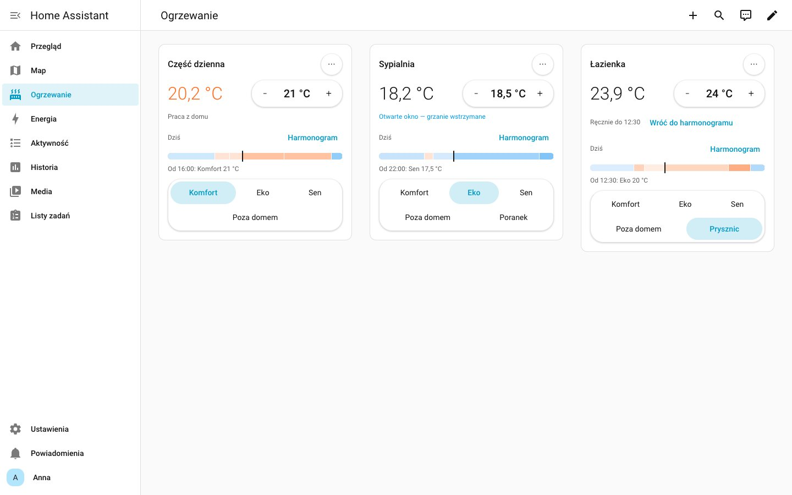

<sub>Wszystkie zrzuty pochodzą z czystego Home Assistanta 2026.11 z domem demonstracyjnym (wirtualne głowice,
czujniki w pokojach i okna) i Heat Zones 1.0, który stawia [`scripts/demo`](scripts/demo/demo.mjs). Wyżej: część
dzienna grzeje, bo ktoś pracuje z domu, sypialnia czeka, bo okno jest otwarte, a łazienka trzyma temperaturę
prysznica do 12:30.</sub>

## Spis treści

- [Co robi Heat Zones](#co-robi-heat-zones)
- [Wymagania](#wymagania)
- [Instalacja](#instalacja)
- [Pierwsza konfiguracja](#pierwsza-konfiguracja)
- [Instrukcja](#instrukcja):
  [Karta](#karta) · [Harmonogram](#harmonogram) · [Nadpisania](#nadpisania) ·
  [Ręczne zmiany i trzymanie](#ręczne-zmiany-i-trzymanie) · [Ustawienia](#ustawienia) ·
  [Na telefonie](#na-telefonie)
- [Jak działa strefa](#jak-działa-strefa)
- [Encje](#encje)
- [Usługi i automatyzacje](#usługi-i-automatyzacje)
- [Wygląd i motyw (Theming)](#wygląd-i-motyw-theming)
- [Kontrakt dla innych systemów](#kontrakt-dla-innych-systemów)
- [Problemy i pytania](#problemy-i-pytania)
- [Rozwój i licencja](#rozwój-i-licencja)

## Co robi Heat Zones

- **Grzeje pokoje, nie kaloryfery.** Głowice z wejściem czujnika pokoju (SONOFF TRVZB / TRV-ZBT i inne) dostają
  temperaturę z pokoju, a głowice bez takiego wejścia dostają cel poprawiony o różnicę między ich termometrem
  a pokojem.
- **Mierzy tam, gdzie mieszkasz.** Jeden pokój, średnio albo najzimniejszy pokój strefy, do tego granice dla
  pokoi: „kuchnia nigdy cieplej niż 23 °C”, choć strefa mierzy średnio.
- **Idzie za tygodniem.** Harmonogram tygodniowy dla każdej strefy, **nagrzewanie na zapas** (optimum start)
  z wyuczonego modelu cieplnego, **ręczne zmiany do najbliższej zmiany**, **trzymanie** do godziny albo na stałe
  i **nadpisania na czas** (goście, praca z domu, wyjazd).
- **Radzi sobie w prawdziwym domu.** Czeka, gdy okno jest otwarte, grzeje dalej **bez czujników** (na własnych
  termometrach głowic), **powtarza zgubione komendy** i **przejmuje obrót pokrętła**.
- **Naprawia się sama.** Głowica, która po cichu wróciła na własny termometr (zdarza się po aktualizacji
  oprogramowania), zostaje przełączona z powrotem; zgłoszenie problemu przychodzi dopiero, gdy to nie pomoże.
  **Strażnik zaworu** zauważa zawór otwarty, przy którym pokój się nie nagrzewa.
- **Uczy się** różnic między pokojami, tempa nagrzewania i **modelu cieplnego** (stygnięcie, moc grzania,
  temperatura na dworze, wiatr), także z historii Home Assistanta.
- **Ma kartę na co dzień.** Strefa teraz, plan na dziś i tryby na pierwszy rzut oka; tydzień, nadpisania
  i ustawienia jedno dotknięcie dalej. Karta jest w zestawie, rejestruje się sama i idzie za Twoim motywem.
- **Rozmawia z innymi systemami.** Plan na 36 godzin, problemy jako sygnały i usługi do odczytu i zmiany
  harmonogramu ([kontrakt](#kontrakt-dla-innych-systemów)).

## Wymagania

- Home Assistant **2026.11** albo nowszy.
- Głowice jako encje `climate`, przypisane do obszarów. Czujniki temperatury w pokojach są bardzo zalecane.
- Opcjonalnie: czujnik temperatury na dworze albo encja pogody z prognozą godzinową (lepsze nagrzewanie na zapas).

## Instalacja

**Przez HACS**

1. Otwórz HACS → ⋮ → *Własne repozytoria*, dodaj `https://github.com/lukasz-wieckowski/heat-zones`, kategoria
   **Integracja**.
2. Znajdź **Heat Zones** w HACS, zainstaluj i uruchom ponownie Home Assistanta.

**Ręcznie**

1. Skopiuj `custom_components/heat_zones` do `config/custom_components/` swojego Home Assistanta.
2. Uruchom ponownie Home Assistanta.

## Pierwsza konfiguracja

**Ustawienia → Urządzenia oraz usługi → Dodaj integrację → Heat Zones.** Kreator pyta o opcjonalny czujnik
temperatury na dworze i encję pogody (oba poprawiają nagrzewanie na zapas) i proponuje utworzenie strefy dla
każdego obszaru z termostatem. Każda strefa ma potem swoje miejsce na stronie integracji, z urządzeniem i encjami:

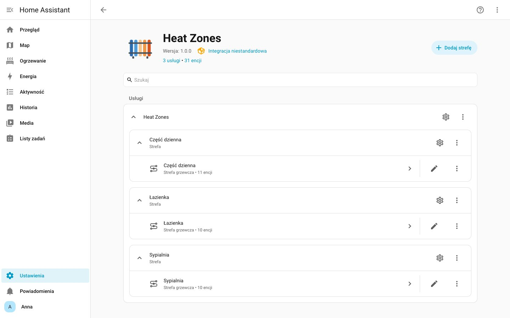

**Dodaj strefę** dodaje nową, koło zębate przy strefie (**Zmień strefę**) ją zmienia, a jej **⋮ → Usuń** usuwa.
Formularz strefy ma cztery kroki:

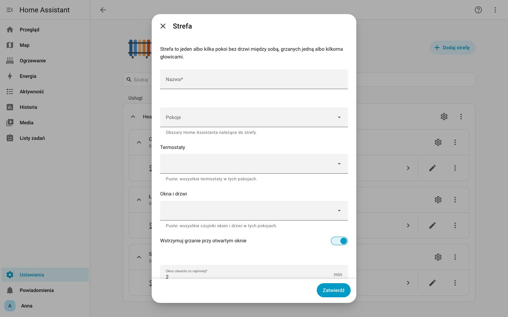

| Krok | O co pyta |
|---|---|
| Strefa | nazwa, pokoje (obszary), termostaty (puste: wszystkie termostaty w tych pokojach), okna i drzwi (puste: wszystkie czujniki okien i drzwi w tych pokojach), pauza przy otwartym oknie i jej opóźnienie |
| Krok dla każdego pokoju | czujnik temperatury pokoju (puste: czujnik ustawiony w obszarze albo znaleziony w pokoju) i opcjonalna granica |
| Tryby | temperatury trybów Komfort, Eko, Sen i Poza domem oraz własne tryby, jeden w linii (`Prysznic: 24`) |
| Sterowanie | jak strefa steruje głowicami (automatycznie, wejście czujnika, poprawiony cel, własny termometr), największa poprawka celu, nagrzewanie na zapas i jak wcześnie może się zacząć oraz encje towarzyszące, gdy nie znalazły się same |

**Konfiguruj** przy integracji ma czujnik na dworze, pogodę i **Początek sezonu grzewczego**: dzień, od którego
grzejesz. Strefy uczą się wtedy stygnięcia pokoi z nocy przed nim, więc nagrzewanie na zapas jest dokładne od
pierwszego dnia.

Na koniec dodaj kartę do pulpitu: *Edytuj pulpit → Dodaj kartę → Heat Zones*, albo w YAML:

```yaml
type: custom:heat-zones-card
entity: climate.czesc_dzienna
```

## Instrukcja

### Karta

Karta odpowiada na codzienne pytanie, jak jest ciepło i co się dziś stanie, a wszystko inne trzyma jedno
dotknięcie dalej (zrzut na górze strony).

| Część | Co pokazuje i robi |
|---|---|
| Nazwa i **⋯** | strefa; **⋯** otwiera jej [ustawienia](#ustawienia) |
| Temperatura | w punkcie pomiaru strefy, w kolorze grzania, gdy strefa grzeje |
| **−** cel **+** | zmienia cel o 0,5 °C ([ręczna zmiana](#ręczne-zmiany-i-trzymanie)) |
| Powód | dlaczego strefa trzyma ten cel: harmonogram, nadpisanie (z jego powodem, np. *Praca z domu*), ręczna zmiana, nagrzewanie na zapas albo pauza przy oknie. Gdy ręczna zmiana jest trzymana, obok stoi **Wróć do harmonogramu** |
| Dziś | dzisiejszy harmonogram i nadpisania jako pasek od północy do północy, chłodniejsze cele na niebiesko, cieplejsze na pomarańczowo; to, co minęło, jest przygaszone, a kreska pokazuje teraz. Pod spodem najbliższa zmiana. **Harmonogram** (albo sam pasek) otwiera [tydzień](#harmonogram) |
| Tryby | Komfort, Eko, Sen, Poza domem i własne, aktywny zabarwiony. Gdy strefa jest wyłączona, zamiast nich jest jeden przycisk **Włącz ogrzewanie** |

Administratorzy widzą też pod powodem problemy strefy (milczący czujnik, zablokowany zawór…).

Opcje karty, wszystkie opcjonalne: `title` (zamiast nazwy strefy) oraz `show_controls` (cel i tryby),
`show_schedule` (pasek i harmonogram) i `show_overrides` (nadpisania w arkuszu harmonogramu), domyślnie włączone.
Edytor karty ma je jako przełączniki.

### Harmonogram

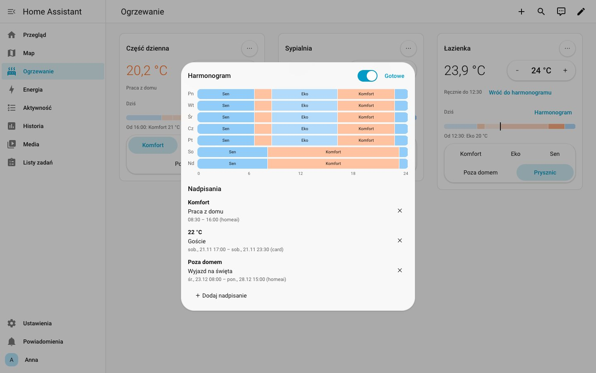

**Harmonogram** otwiera tydzień w arkuszu. Przełącznik u góry włącza i wyłącza harmonogram (wyłączony: strefa
trzyma ręczne ustawienia). Każdy dzień to pasek od 0 do 24; blok trwa do następnego, także przez kolejne dni
i tygodnie. Pod tygodniem są nadpisania.

Dotknij dnia, żeby go zmienić:

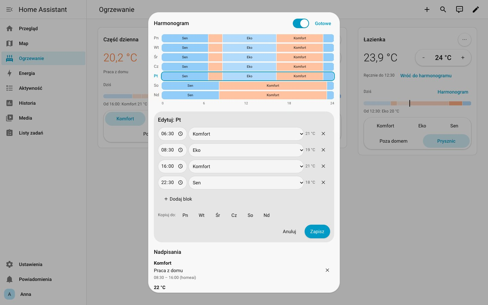

Każdy blok to godzina i tryb albo temperatura; obok trybu widać jego temperaturę. **Dodaj blok** dodaje blok dwie
godziny po ostatnim, **✕** usuwa blok, a **Kopiuj do** kopiuje dzień na wybrane dni przy zapisie. **Zapisz**
zapisuje tydzień, **Anuluj** porzuca zmiany.

### Nadpisania

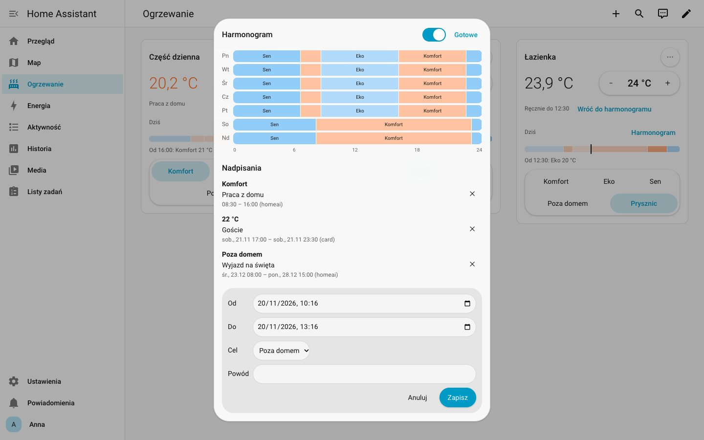

Nadpisanie to cel na jakiś czas: od, do, tryb albo temperatura i powód. Wygrywa z harmonogramem i znika samo, gdy
się skończy. **Dodaj nadpisanie** otwiera formularz (od teraz, na trzy godziny), a **✕** usuwa nadpisanie. Przy
każdym widać, skąd przyszło: `card` z tego formularza, `homeai` z HomeAI albo `source` tego, kto wywołał
`heat_zones.add_override`. Wyżej HomeAI trzyma ciepło w części dziennej, bo ktoś pracuje z domu, jutro wieczorem
przychodzą goście, a na święta cały dom jest *Poza domem*.

### Ręczne zmiany i trzymanie

Zmiana z karty (**−** / **+**, tryb), z pokrętła głowicy, pilota, głosem albo z innego systemu to **ręczna
zmiana**. Przy włączonym harmonogramie trwa **do najbliższej zmiany**: następnego bloku albo początku lub końca
nadpisania. Żeby trzymać ją dłużej, otwórz **⋯** i wybierz **Trzymaj na stałe** (harmonogram czeka, aż do niego
wrócisz) albo **Trzymaj do** godziny. **Wróć do harmonogramu** wraca do harmonogramu od razu.

Między nadpisaniami a ręcznymi zmianami **wygrywa najnowsze polecenie**: ręczna zmiana wygrywa z trwającym
nadpisaniem; nadpisanie, które zaczyna się później, wygrywa z wcześniejszym trzymaniem, a gdy się skończy, trzymanie
wraca.

### Ustawienia

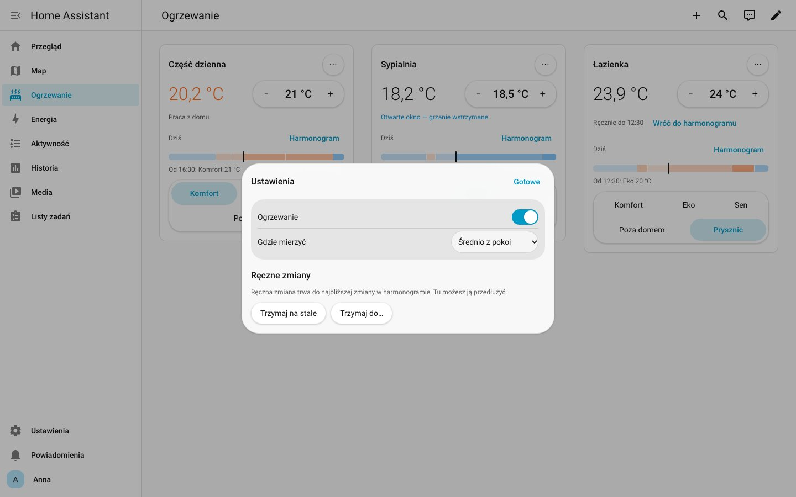

**⋯** otwiera ustawienia strefy:

- **Ogrzewanie**: włączone albo wyłączone. Wyłączone wyłącza głowice, a harmonogram czeka.
- **Gdzie mierzyć**: pokój, średnio z pokoi albo najzimniejszy pokój (strefy z więcej niż jednym czujnikiem).
- **Ręczne zmiany**: trzymanie obecnej ręcznej zmiany na stałe albo do godziny, albo powrót do harmonogramu.

Cała reszta strefy jest w jej konfiguracji: koło zębate przy strefie (**Zmień strefę**) na stronie integracji.

### Na telefonie

<p>
  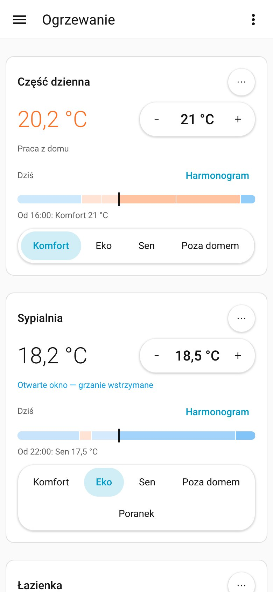
  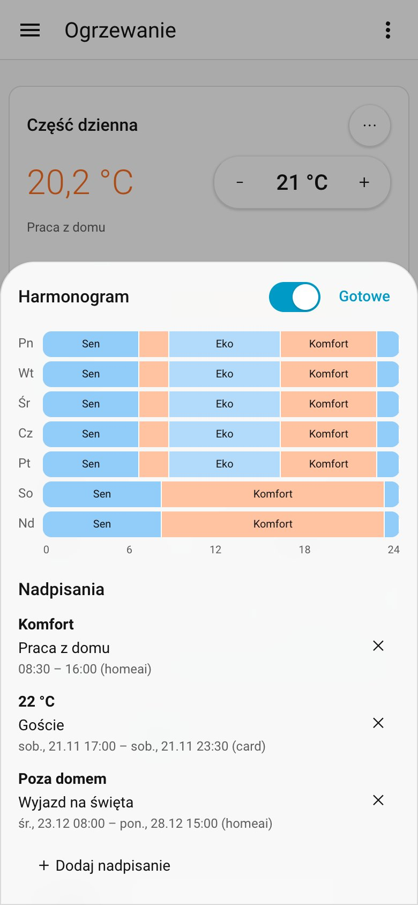
</p>

Na telefonie karty zajmują całą szerokość, a arkusze wysuwają się od dołu. Arkusz zamyka **Gotowe**, klawisz
Escape albo dotknięcie poza nim.

## Jak działa strefa

**Punkt pomiaru.** `select.<strefa>_measure_at`: pokój, `average` (średnio) albo `coldest` (najzimniejszy). Gdy
czujnik wybranego pokoju milczy, strefa bierze pozostałe pokoje; gdy przez 15 minut nie ma żadnego odczytu z pokoi,
głowice wracają na własne termometry, a strefa zgłasza problem. Krótsza przerwa, np. czujniki chwilę bez wartości
po restarcie Home Assistanta albo Zigbee2MQTT, niczego nie zmienia.

**Sterowanie głowicami** (dla każdej głowicy, domyślnie *automatycznie*):

| Tryb | Kiedy | Co strefa wysyła |
|---|---|---|
| Wejście czujnika pokoju | głowica ma wejście temperatury zewnętrznej (szukane po `unique_id`, np. `external_temperature_input` i `temperature_sensor_select` z Zigbee2MQTT) | temperaturę pokoju (podniesioną przez pokoje z granicą) i cel strefy |
| Poprawiony cel | brak takiego wejścia, ale są czujniki w pokojach | cel + (termometr głowicy − pokój), wygładzony i ograniczony (domyślnie ±3 °C) |
| Własny termometr | brak czujników w pokojach albo wybrany | cel strefy |

**Granice pokoi.** Dla każdego pokoju z granicą strefa podaje `max(punkt, T_pokoju − (granica − cel))`, więc
głowica zamyka się, gdy pokój z granicą do niej dojdzie. Encja climate pokazuje, który pokój ogranicza strefę
(`limited_by`), a z nauki: najwyższą temperaturę, jaką punkt pomiaru może osiągnąć (`max_reachable`).

**Pauza przy oknie.** Okno albo drzwi otwarte dłużej niż opóźnienie (domyślnie 2 min) wyłączają głowice do
zamknięcia (`binary_sensor.<strefa>_window_pause`). Długo otwarte okno przy grzaniu staje się też sygnałem.

**Limit zaworu.** Gdy głowice mają ustawienie otwarcia zaworu, `number.<strefa>_valve_limit` ustawia je dla
wszystkich.

**Co strefa trzyma.** Od dołu:

1. **Harmonogram** (gdy włączony i niepusty), inaczej ręczny cel.
2. **Nadpisania**: od–do, tryb albo temperatura, z powodem i źródłem. Wygrywają z harmonogramem i znikają same.
3. **Ręczne zmiany**: do najbliższej zmiany przy włączonym harmonogramie; trzymane do godziny albo na stałe przez
   `heat_zones.hold`, z powrotem do harmonogramu przez `heat_zones.resume`.

**Nagrzewanie na zapas (optimum start).** Przed cieplejszym krokiem strefa zaczyna grzać na tyle wcześnie, żeby
zdążyć, z modelu cieplnego, zmierzonej temperatury i prognozy temperatury na dworze, najwyżej *Zaczynaj nagrzewać
najwyżej* godzin wcześniej (domyślnie 3). Zanim model się nauczy, liczą się wartości domyślne; po kilku dniach
grzania (albo od razu z *Początkiem sezonu grzewczego*) jest dokładny.

**Nauka.** Strefa uczy się różnicy każdego pokoju względem punktu pomiaru, tempa nagrzewania i modelu cieplnego
(stygnięcie, moc grzania, wpływ temperatury na dworze i wiatru). Czujniki diagnostyczne pokazują, ile już wie;
`heat_zones.reset_learning` zaczyna od nowa.

`sensor.<strefa>_next_change` pokazuje, kiedy cel zmieni się następnym razem, na jaki i dlaczego (`schedule`,
`override`, `hold`, `preheat`).

## Encje

Każda strefa jest urządzeniem z takimi encjami:

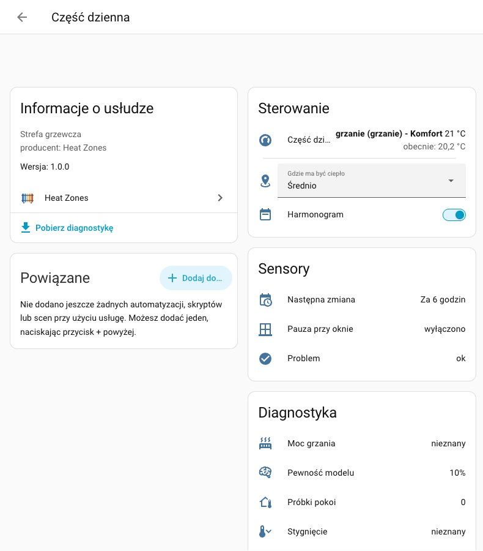

| Encja | Co |
|---|---|
| `climate.<strefa>` | cel w punkcie pomiaru, `heat`/`off`, tryby `comfort`, `eco`, `sleep`, `away` i własne; atrybuty niżej |
| `switch.<strefa>_schedule` | harmonogram wł./wył. |
| `sensor.<strefa>_next_change` | najbliższa zmiana (znacznik czasu; `temperature`, `preset_mode`, `source`, `reason`) |
| `select.<strefa>_measure_at` | gdzie strefa mierzy (strefy z więcej niż jednym czujnikiem) |
| `binary_sensor.<strefa>_problem` | coś wymaga uwagi (`device_class: problem`) |
| `binary_sensor.<strefa>_window_pause` | grzanie wstrzymane przez otwarte okno |
| `number.<strefa>_valve_limit` | limit otwarcia zaworu (głowice z takim ustawieniem) |
| `sensor.<strefa>_heating_rate`, `_cooling_rate`, `_heating_power`, `_model_confidence`, `_room_samples` | nauka i model cieplny (diagnostyka) |

Atrybuty climate: `measure_at`, `rooms` (temperatura, czujnik, granica, wyuczona różnica i przewidywana
temperatura każdego pokoju), `thermostats` (encja i tryb sterowania), `room_temperature_sent`, `limited_by`,
`max_reachable`, `reach_at` (kiedy cel ma być osiągnięty), `window_pause`, `open_windows`, `problem`, `source`,
`reason`, `override_id`, `hold`, `schedule_enabled`, `preset_temperatures`, `next_change` i atrybuty kontraktu.

## Usługi i automatyzacje

| Usługa | Co robi |
|---|---|
| `heat_zones.hold` | trzyma temperaturę albo tryb do godziny (`until`) albo na stałe (`permanent`) |
| `heat_zones.resume` | wraca do harmonogramu |
| `heat_zones.add_override` / `remove_override` | cel na jakiś czas, z powodem i źródłem |
| `heat_zones.get_schedule` / `set_schedule` | odczyt albo zamiana tygodnia (i odczyt nadpisań) |
| `heat_zones.estimate` | ile minut grzania trzeba do danej temperatury |
| `heat_zones.reset_learning` | kasuje to, czego strefa się nauczyła |

Działają też zwykłe akcje `climate`: żeby ustawić tryb we wszystkich strefach naraz, wywołaj
`climate.set_preset_mode` ze wszystkimi termostatami stref jako celem. Pola i odpowiedzi są w
[kontrakcie](#kontrakt-dla-innych-systemów).

**Poza domem, gdy nikogo nie ma**, i powrót, gdy ktoś przyjdzie:

```yaml
- alias: Ogrzewanie poza domem, gdy nikogo nie ma
  triggers:
    - trigger: numeric_state
      entity_id: zone.home
      below: 1
      for: { minutes: 30 }
  actions:
    - action: heat_zones.hold
      target:
        entity_id: [climate.czesc_dzienna, climate.sypialnia, climate.lazienka]
      data:
        preset_mode: away
        permanent: true
- alias: Ogrzewanie wraca, gdy ktoś przyjdzie
  triggers:
    - trigger: numeric_state
      entity_id: zone.home
      above: 0
  actions:
    - action: heat_zones.resume
      target:
        entity_id: [climate.czesc_dzienna, climate.sypialnia, climate.lazienka]
```

**Goście w sobotę wieczorem**, w skrypcie albo automatyzacji:

```yaml
action: heat_zones.add_override
target:
  entity_id: climate.czesc_dzienna
data:
  start: "2026-11-21T17:00:00"
  end: "2026-11-21T23:30:00"
  temperature: 22
  reason: Goście
  source: script
```

**Daj znać, gdy strefa ma problem:**

```yaml
- alias: Problem z ogrzewaniem
  triggers:
    - trigger: state
      entity_id: binary_sensor.czesc_dzienna_problem
      to: "on"
      for: { minutes: 10 }
  actions:
    - action: notify.notify
      data:
        message: >-
          {{ state_attr('climate.czesc_dzienna', 'homeai_signals') | map(attribute='title') | join('; ') }}
```

## Wygląd i motyw (Theming)

Karta i oba elementy edytora nie mają własnych kolorów, czcionek, rozmiarów, promieni, cieni ani odstępów: wszystko
bierze z motywu Home Assistanta. Bez ustawień karta idzie za aktywnym motywem, jasnym albo ciemnym. Motyw (albo
karta, która osadza `<heat-zones-schedule-editor>` / `<heat-zones-overrides>`) może ją przestylować zmiennymi
poniżej, bez ruszania reszty Home Assistanta. Ustawia się je w motywie (bez początkowego `--`), na elemencie
nadrzędnym albo na samym elemencie karty. Ramka karty (`ha-card`: tło, obramowanie, promień, cień) idzie za zwykłymi
zmiennymi `--ha-card-*`, jak w każdej karcie.

Domyślny wygląd idzie za Liquid Glass Apple, przeniesionym na web. Treść (temperatury, tydzień, lista nadpisań)
zostaje zwykła; szkło jest tylko dla kontrolek, które unoszą się nad nią. Kontrolki, które należą do siebie, mają
jeden wspólny szklany pojemnik (tryby, trzymanie, − / +), a przyciski w środku same nie są ze szkła. Wybrana opcja
jest zabarwiona, akcja główna (Zapisz, Trzymaj) wypełniona kolorem akcentu, rogi są koncentryczne (pojemnik =
kontrolka + odstęp), a edycja dnia i dodawanie nadpisania otwierają się w uniesionym szklanym arkuszu. Wciśnięcie
kontrolki daje krótkie zmniejszenie. Przy systemowym *ograniczeniu przezroczystości* albo *większym kontraście*
szkło staje się pełne (większy kontrast rysuje też mocniejsze krawędzie), a przy *ograniczeniu ruchu* nie ma
animacji wciśnięcia.

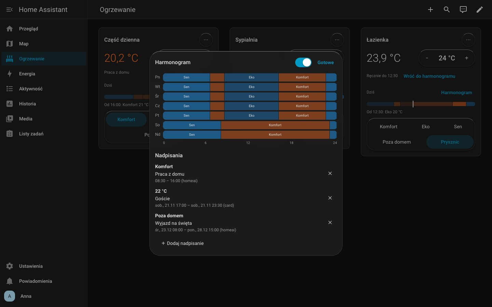

```yaml
# themes.yaml
moj_motyw:
  heat-zones-accent-color: "#e0a040"
  heat-zones-heating-color: "#ff7a1a"
  heat-zones-button-border-radius: 6px
  heat-zones-schedule-strength: 100%
```

**Pismo**

| Zmienna | Domyślnie | Do czego |
| --- | --- | --- |
| `--heat-zones-font-family` | `--ha-font-family-body` | Cały tekst (następczyni `--primary-font-family` w HA) |
| `--heat-zones-font-size` | `--ha-font-size-m` | Zwykły tekst |
| `--heat-zones-small-font-size` | `--ha-font-size-s` | Linie drugorzędne, nazwy dni, problemy |
| `--heat-zones-tiny-font-size` | `--ha-font-size-xs` | Napisy na paskach dni, godziny |
| `--heat-zones-title-font-size` | `--ha-font-size-l` | Nazwa strefy, tytuły sekcji |
| `--heat-zones-title-font-weight` | `--ha-font-weight-medium` | Tytuły, wybrane przyciski i dni, cel |
| `--heat-zones-temperature-font-size` | `--ha-font-size-4xl` | Bieżąca temperatura |
| `--heat-zones-temperature-font-weight` | `--ha-font-weight-light` | Bieżąca temperatura |
| `--heat-zones-target-font-size` | `--ha-font-size-xl` | Cel między − i + |
| `--heat-zones-line-height` | `--ha-line-height-normal` | Cały tekst |
| `--heat-zones-condensed-line-height` | `--ha-line-height-condensed` | Bieżąca temperatura |

**Odstępy i kształt**

| Zmienna | Domyślnie | Do czego |
| --- | --- | --- |
| `--heat-zones-card-padding` | `--ha-space-4` | Wnętrze karty |
| `--heat-zones-gap` | `--ha-space-2` | Między przyciskami, wierszami i pozycjami listy |
| `--heat-zones-small-gap` | `--ha-space-1` | Między paskami dni, pod temperaturą |
| `--heat-zones-section-gap` | `--ha-space-4` | Nad i pod liniami między sekcjami |
| `--heat-zones-control-height` | `--ha-space-10` | Najmniejsza wysokość przycisków i pól (pole dotyku) |
| `--heat-zones-control-padding` | `--ha-space-2` `--ha-space-4` | Wnętrze przycisków |
| `--heat-zones-input-padding` | `--ha-space-1` `--ha-space-2` | Wnętrze pól |
| `--heat-zones-group-padding` | `--ha-space-1` | Wnętrze szklanej grupy, wokół przycisków |
| `--heat-zones-sheet-padding` | `--ha-space-3` | Wnętrze arkusza |
| `--heat-zones-bar-height` | `--ha-space-6` | Paski dni harmonogramu |
| `--heat-zones-ribbon-height` | `--ha-space-3` | Pasek dzisiejszego dnia na karcie |
| `--heat-zones-border-width` | `--ha-border-width-sm` | Krawędzie szkła, pól i linie |
| `--heat-zones-focus-width` | `--ha-border-width-md` | Obwódka edytowanego dnia |
| `--heat-zones-button-border-radius` | `--ha-border-radius-pill` | Przyciski (kapsuły) |
| `--heat-zones-icon-button-border-radius` | `--ha-border-radius-pill` | −, +, ✕ i przyciski dni |
| `--heat-zones-input-border-radius` | `--ha-border-radius-pill` | Pola |
| `--heat-zones-group-border-radius` | pół wysokości kontrolki + odstęp grupy | Szklane grupy (koncentrycznie z przyciskami) |
| `--heat-zones-sheet-border-radius` | pół wysokości kontrolki + odstęp arkusza | Arkusze (koncentrycznie z polami) |
| `--heat-zones-bar-border-radius` | `--ha-border-radius-md` | Paski dni |
| `--heat-zones-ribbon-border-radius` | `--ha-border-radius-pill` | Pasek dzisiejszego dnia |

**Kolory**

| Zmienna | Domyślnie | Do czego |
| --- | --- | --- |
| `--heat-zones-text-color` | `--primary-text-color` | Tekst |
| `--heat-zones-secondary-text-color` | `--secondary-text-color` | Linie drugorzędne, nazwy dni, godziny |
| `--heat-zones-disabled-text-color` | `--disabled-text-color` | Wyłączone przyciski |
| `--heat-zones-accent-color` | `--primary-color` | Wybrane przyciski, edytowany dzień, Zapisz |
| `--heat-zones-on-accent-color` | `--text-primary-color` | Tekst na kolorze akcentu |
| `--heat-zones-selected-color` | 18 % koloru akcentu | Zabarwienie wybranej opcji |
| `--heat-zones-hover-color` | `--secondary-background-color` | Przycisk pod kursorem |
| `--heat-zones-divider-color` | `--divider-color` | Pola i linie |
| `--heat-zones-input-background-color` | `--input-fill-color` | Pola |
| `--heat-zones-inset-color` | `--secondary-background-color` | Panele w arkuszu (ustawienia, edytowany dzień) |
| `--heat-zones-past-color` | 55 % `--card-background-color` | Welon na minionej części dnia |
| `--heat-zones-switch-off-color` | `--disabled-color` | Tor przełącznika, gdy wyłączony (włączony ma kolor akcentu) |
| `--heat-zones-switch-knob-color` | `--text-primary-color` | Gałka przełącznika |
| `--heat-zones-track-color` | `--secondary-background-color` | Pasek dnia bez bloków |
| `--heat-zones-heating-color` | `--state-climate-heat-color` | Bieżąca temperatura, gdy strefa grzeje |
| `--heat-zones-window-color` | `--state-binary_sensor-window-on-color`, inaczej `--info-color` | Linia powodu w czasie pauzy przy oknie |
| `--heat-zones-problem-color` | `--state-binary_sensor-problem-on-color`, inaczej `--error-color` | Problemy strefy (z `homeai_signals`) |

**Szkło**

| Zmienna | Domyślnie | Do czego |
| --- | --- | --- |
| `--heat-zones-glass-color` | `--card-background-color` | Kolor materiału szkła |
| `--heat-zones-glass-opacity` | `70%` | Ile z niego zakrywa to, co pod spodem (100% = pełne) |
| `--heat-zones-glass-blur` | `--ha-space-4` | Rozmycie tego, co pod spodem |
| `--heat-zones-glass-border-color` | `--divider-color` | Krawędź szkła |
| `--heat-zones-glass-highlight-color` | krawędź zmieszana z `--ha-color-white` | Oświetlona górna krawędź |
| `--heat-zones-glass-shadow` | `--ha-box-shadow-s` | Głębia grup, przycisków i akcji głównej |
| `--heat-zones-sheet-shadow` | `--ha-box-shadow-m` | Głębia arkuszy |
| `--heat-zones-sheet-opacity` | `92%` | Jak pełne są arkusze |
| `--heat-zones-scrim-filter` | `--ha-dialog-scrim-backdrop-filter` | Jak przyciemniona jest strona pod otwartym arkuszem |
| `--heat-zones-sheet-duration` | `--ha-animation-duration-normal` | Wysuwanie arkusza |
| `--heat-zones-transition-duration` | `--ha-animation-duration-fast` | Reakcja na wciśnięcie i najechanie |
| `--heat-zones-press-scale` | `0.97` | Rozmiar wciśniętej kontrolki |

**Paski harmonogramu.** Kolor bloku to jego cel na skali chłodno–ciepło: poniżej 19,75 °C kolor zimny, od 19,75 °C
ciepły, wmieszany w kolor bazowy — przy środku jedna trzecia `--heat-zones-schedule-strength`, w całości przy 16 °C
i niżej albo 23 °C i wyżej (`color-mix(in srgb, odcień udział × siła, baza)`).

| Zmienna | Domyślnie | Do czego |
| --- | --- | --- |
| `--heat-zones-cold-color` | `--state-climate-cool-color` | Chłodniejsze cele |
| `--heat-zones-warm-color` | `--state-climate-heat-color` | Cieplejsze cele |
| `--heat-zones-unknown-color` | `--disabled-color` | Tryb bez temperatury |
| `--heat-zones-schedule-base-color` | `--card-background-color` | W co mieszane są kolory; linie między blokami |
| `--heat-zones-schedule-text-color` | `--primary-text-color` | Napisy na paskach |
| `--heat-zones-schedule-strength` | `70%` | Jak mocne są kolory na końcach skali |

**Części (`::part`).** Gdzie zmienna nie wystarcza, elementy stylujesz przez `::part()`. Część może mieć też nazwę
stanu, np. `::part(segment warm)` albo `::part(button active)`. Karta przekazuje dalej części edytorów, więc
`heat-zones-card::part(segment)` też działa.

```css
heat-zones-card::part(title) { text-transform: uppercase; }
heat-zones-schedule-editor::part(day-bar) { border-radius: 0; }
```

| Element | Części (nazwy stanów) |
| --- | --- |
| `heat-zones-card` | `card`, `header`, `title`, `temperature` (`heating`), `reason` (`window`), `problem`, `today`, `segment` (`cold`, `warm`, `unknown`), `past`, `now`, `next`, `target` (`group`, `glass`), `target-value`, `controls` (`group`, `glass`), `button` (`active`, `primary`, `icon`, `glass`, `link`), `dialog`, `sheet` (`glass`), `sheet-title`, `section-title`, `settings` (`inset`), `setting`, `switch` (`on`), `input`, `message` |
| `heat-zones-schedule-editor` | `week`, `day-label` (`selected`), `day-bar` (`selected`), `segment` (`cold`, `warm`, `unknown`), `hours`, `blocks` (`sheet`, `glass` albo `inset`), `sheet-title`, `block`, `input`, `button` (`active`, `primary`, `icon`), `message` |
| `heat-zones-overrides` | `list`, `override`, `form` (`sheet`, `glass` albo `inset`), `input`, `button` (`primary`, `icon`, `glass`), `message` |

`::part(glass)` sięga naraz do każdej szklanej powierzchni, np. żeby dać im inny materiał.

## Kontrakt dla innych systemów

Heat Zones publikuje, co zrobi, i przyjmuje zmiany od systemów takich jak HomeAI. Ten sam kontrakt może spełnić
każda integracja termostatu.

**Atrybuty `climate.<strefa>`:**

- `homeai_schedule` = `{"version": 1, "domain": "heat_zones", "areas": [...], "features": ["open_end"]}`: ten
  termostat obsługuje kontrakt; `areas` (opcjonalne w innych implementacjach) to identyfikatory obszarów, które
  strefa grzeje (urządzenie strefy nie ma obszaru, więc systemy powinny czytać pokoje stąd); `features` to
  opcjonalne części wersji 1, które termostat rozumie, a nadawcy używają `open_end` tylko z termostatami, które je
  wymieniają.
- `homeai_plan` = lista `{start, title, end?}` (czasy ISO): harmonogram, nadpisania, trzymanie i nagrzewanie na
  zapas na najbliższe 36 godzin, najwyżej 50 pozycji. Pusta, gdy strefa jest wyłączona.
- `homeai_signals` = lista `{id, title, severity 0–4, category, description?, need?, group?}`: problemy strefy
  (milczący czujnik, zablokowany zawór, otwarte okno przy grzaniu, głowica bez czujnika pokoju, niedostępne
  głowice), jak w
  [docs/integrations.md](https://github.com/lukasz-wieckowski/homeai/blob/main/docs/integrations.md) HomeAI.

**Usługi**: celem są encje climate stref (działa cel encją, urządzeniem, obszarem albo etykietą):

| Usługa | Pola | Odpowiedź |
|---|---|---|
| `heat_zones.add_override` | `end` (wymagane), `start` (domyślnie teraz), dokładnie jedno z `preset_mode` / `temperature`, `reason` (≤ 200 znaków), `source`, `override_id` (ten sam identyfikator zastępuje nadpisanie), `open_end` (opcjonalne, domyślnie false) | `{override_id}` |
| `heat_zones.remove_override` | `override_id` albo `source` (usuwa wszystkie nadpisania z tego źródła); bez celu: wszystkie strefy | `{removed}` |
| `heat_zones.get_schedule` | bez celu: wszystkie strefy | `{entity_id: {enabled, weekly: [{days: ["mon", …], time: "HH:MM", preset_mode \| temperature}], overrides: [{override_id, start, end, preset_mode \| temperature, reason, source, open_end?}]}}` |
| `heat_zones.set_schedule` | `weekly` w tym samym formacie | — |
| `heat_zones.estimate` | `temperature` | `{entity_id: {minutes \| null, confidence 0–1}}` |
| `heat_zones.reset_learning` | — | — |

Szczegóły:

- `add_override` z `override_id`, którego jeszcze nie ma, tworzy nadpisanie pod tym identyfikatorem (upsert);
  `override_id` ma 1–80 znaków, `source` najwyżej 60. Nadpisanie wysłane ponownie **bez zmian** (ten sam początek,
  koniec i wartość) zachowuje swój wiek, więc ponowne wysłanie po restarcie nie cofa ręcznej zmiany zrobionej
  w międzyczasie; zmienione jest nowym poleceniem.
- Czasy w ISO 8601 (bez przesunięcia: czas lokalny). Nadpisanie może zacząć się w przeszłości; koniec musi być
  w przyszłości i po początku, a całość może trwać najwyżej 90 dni. `preset_mode` musi istnieć w każdej strefie
  z celu.
- **Nadpisania bez końca** (`open_end: true`): koniec jest tylko horyzontem. Nadawca przedłuża nadpisanie, dopóki
  trwa powód (nikogo w domu, tryb urlopowy), i usuwa je, gdy powód minie. Aktywne nadpisanie zawsze wygrywa
  z harmonogramem; strefa nigdy nie nagrzewa na zapas pod horyzont (pod prawdziwy koniec, np. powrót z wyjazdu,
  tak). Przedłużenie (ten sam identyfikator i wartość, późniejszy koniec, ten sam początek albo początek „teraz”, gdy
  już trwa) zachowuje wiek i początek nadpisania, więc nie wygrywa z ręczną zmianą zrobioną w międzyczasie. Jeśli
  nikt go nie przedłuży, na horyzoncie po prostu wraca harmonogram. `get_schedule` zwraca przy takich nadpisaniach
  `open_end: true`.
- `remove_override` z nieznanym identyfikatorem nic nie usuwa (`{removed: 0}`) i nie jest błędem.
- `set_schedule` zastępuje cały tydzień; dni to `mon` … `sun`, godziny `HH:MM`, temperatury 5–30 °C (zaokrąglane
  do 0,5). Harmonogram niepoprawny dla którejkolwiek strefy z celu nie zmienia żadnej.
- `estimate` podaje minuty ciągłego grzania od teraz (0, gdy już jest ciepło, `null` bez temperatury pokoju albo
  gdy w 12 godzin się nie da).
- **Kto zmienił**: stany zapisane przez usługę Heat Zones niosą kontekst wywołującego, a zmiany na termostacie
  strefy kontekst, który daje im Home Assistant; własne zmiany integracji (harmonogram, nagrzewanie na zapas,
  koniec nadpisania albo trzymania) dostają świeży kontekst bez użytkownika. Atrybut `source` (`schedule`,
  `override`, `hold`, `manual`, `preheat`) mówi to samo bez kontekstów: `hold` i `manual` to zmiana człowieka, także
  obrót pokrętła. `source` i `preset_temperatures` (tryb → °C) są częścią kontraktu i się nie zmieniają.

Przykład: HomeAI wie o wyjeździe.

```yaml
action: heat_zones.add_override
target:
  entity_id: [climate.czesc_dzienna, climate.sypialnia]
data:
  start: "2026-12-20T08:00:00+01:00"
  end: "2026-12-27T16:00:00+01:00"
  preset_mode: away
  reason: Wyjazd na święta
  source: homeai
  override_id: homeai-trip-2026-12
response_variable: result
```

Poza kontraktem trzymaniem sterują `heat_zones.hold` (`temperature` albo `preset_mode`, `until` albo `permanent`)
i `heat_zones.resume`.

## Problemy i pytania

**Kreator nie znajduje termostatów albo pokoi.** Termostaty muszą być encjami `climate` w obszarze: własnym albo
obszarze swojego urządzenia. Ukryte termostaty i same strefy są pomijane. Przypisz głowice do pokoi (*Ustawienia →
Obszary*) i dodaj strefę jeszcze raz albo wybierz je w formularzu strefy.

**Dodałem głowicę albo czujnik w pokoju.** Strefy zbudowane z obszarów to zauważą: nowa głowica albo czujnik
w pokoju strefy przebudowuje strefy po chwili.

**Strefa bierze zły czujnik pokoju.** Czujnik pokoju to czujnik temperatury ustawiony w obszarze w Home Assistancie
(*Ustawienia → Obszary → obszar → Czujnik temperatury*); bez niego czujnik temperatury w pokoju na urządzeniu,
które niczym nie steruje (termometr głowicy czy zmywarki nic nie mówi o pokoju, czujnik rośliny też nie). Żeby
wybrać inny, otwórz **Zmień strefę** i wybierz go w kroku pokoju.

**Pauza przy oknie nie działa.** Czujnik musi mieć klasę urządzenia `window`, `door`, `opening` albo
`garage_door` i być w jednym z pokoi strefy (albo wybrany w formularzu strefy); czujnik na urządzeniu, które czymś
steruje, jest pomijany. Pauza zaczyna się po opóźnieniu (domyślnie 2 min) i widać ją jako
`binary_sensor.<strefa>_window_pause`.

**Zmiana na głowicy zniknęła.** Przy włączonym harmonogramie ręczna zmiana trwa do najbliższej zmiany
w harmonogramie. Zatrzymaj ją przez **⋯ → Trzymaj na stałe** albo **Trzymaj do**, albo wyłącz harmonogram.

**Nagrzewanie na zapas zaczyna się za wcześnie albo za późno.** Model cieplny potrzebuje kilku dni grzania. Ustaw
**Początek sezonu grzewczego** w opcjach integracji, żeby uczył się z historii sprzed instalacji; *Zaczynaj nagrzewać
najwyżej* w kroku Sterowanie strefy ogranicza, jak wcześnie może zacząć. `sensor.<strefa>_model_confidence`
pokazuje, jak pewny jest model.

**Czujnik problemu jest włączony.** Atrybut `problem` strefy mówi, co jest nie tak: `sensor` (od 15 minut brak odczytu z
pokoi), `thermostat` (głowica nie korzysta z czujnika pokoju, a samonaprawa nie pomogła) albo `unavailable` (głowice
niedostępne od 15 minut); `homeai_signals` ma czytelny tytuł. Administratorzy widzą to samo na karcie.

**Karty nie ma na liście kart.** Integracja sama udostępnia i rejestruje kartę; po instalacji albo aktualizacji
odśwież stronę (w aplikacji Companion: wyczyść jej pamięć podręczną interfejsu). Nie trzeba dodawać zasobu.

**Co Heat Zones wysyła poza dom?** Nic. Czyta tylko encje i historię Twojego Home Assistanta.

**Jak zacząć naukę od nowa?** `heat_zones.reset_learning` na strefie albo na wszystkich.

**Co dołączyć do zgłoszenia błędu?** *⋮ → Pobierz diagnostykę* przy integracji: konfigurację, stan i naukę stref.

## Rozwój i licencja

Zobacz [CONTRIBUTING.md](CONTRIBUTING.md); jest tam też, jak odtworzyć dom demonstracyjny i zrzuty. Heat Zones
wyrosło z prywatnej integracji *Strefy ciepła* (wersja 1.10), bez jej trybu automatycznego: planowanie z obecności
i nawyków należy do systemów takich jak HomeAI, które korzystają z kontraktu.

[Apache 2.0](LICENSE)
